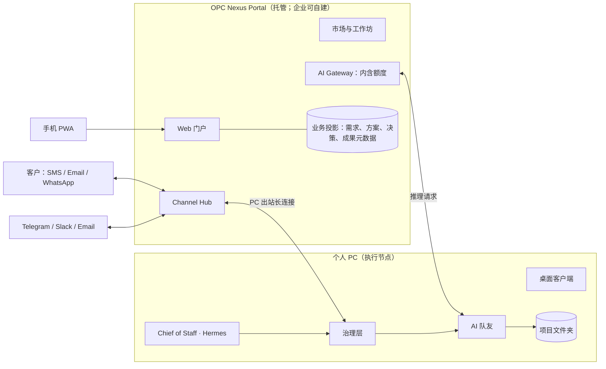
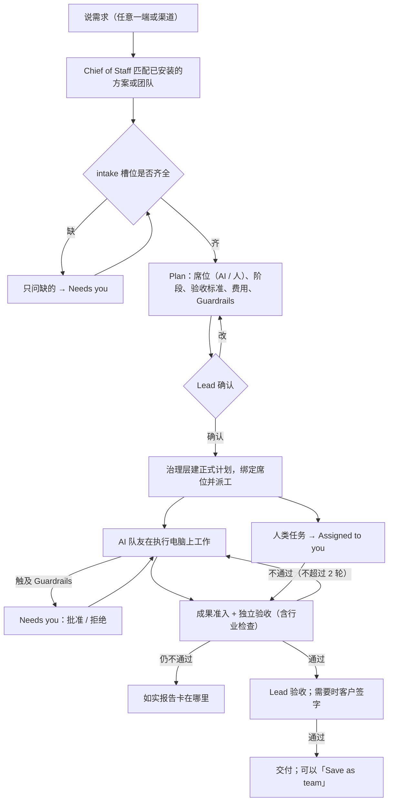

# 产品设计：业务需求驱动的 AI Agent Teams

> 日期：2026-10-12（v3）
> 状态：设计提案，尚未实施
> 适用基线：v2.0.1（Hermes 为唯一调度，`opc-nexus-governance` 为事实源）
> 交互原型（英文）：<https://claude.ai/artifact/8464N7HPA4Xwthxbma1uPp>（13 个画板）

## 决策记录

| # | 决策 | 状态 | 影响章节 |
|---|---|---|---|
| D1 | 专家团（`teamEngine` 协调循环）退役，Hermes 保持唯一调度；团队只作为模板数据 | 已定 | §5.3 |
| D2 | 市场放在一级导航 | 已定 | §9、§11 |
| D3 | 新产品以**英文为默认语言**，面向全球英语市场；中文作为次要语言保留 | 已定 | §4、§8、§12 |
| D4 | 渠道改造：飞书、企微、微信 iLink 退出国际版，换成全球渠道 | 已定 | §8 |
| D5 | 主要对象是 prosumer 和一人公司，同时支持「人和 AI 一起工作」的小团队 | 已定 | §2、§5、§6 |
| D6 | 分发以行业 Solution 为产品入口（自媒体、房产经纪、理财顾问、保险经纪、个人电商、视觉创作者、本地服务小公司等） | 已定 | §2.2、§11 |
| D7 | 租户与权限模型：老板是 Workspace 的 **Owner**，Owner 默认拥有全部管理员权限；Owner 与 Admin 分开 | 已定 | §6 |
| D8 | 默认用「内含 AI 额度」代替让用户填 API Key；自带密钥作为高级选项 | 已定 | §6.6 |
| D9 | 目前没有中国区用户：国际版直接移除飞书、企微、微信 iLink，不保留地区包 | 已定 | §8.5 |
| D10 | 调度器：暂不更换 Hermes；先定义可替换的 Chief of Staff 接口，P2 前用真实场景对比 Hermes / Mastra / Claude Agent SDK 后再决定 | 建议，待确认 | §16 |
| D11 | ICP 补充：独立顾问提前到个人电商之前；代运营 / 虚拟助理公司作为 P3 的渠道策略；短租房东、独立出版作者进入第二批 | 建议，待确认 | §2.3 |

## 0. 摘要

**定位**：*An AI team that works for your business — you say what you need, approve the plan, and get finished work back.* 面向全球的 prosumer 和一人公司。老板用业务语言说出需求，系统按其所在行业配好的团队给出方案、费用和底线；老板确认后，AI 队友和人类伙伴一起完成工作，交付经过独立验收、可以打开的成果。

核心设计：

1. **界面只有业务名词**：Request、Plan、Team、Deliverables、Spend、Guardrails。引擎、模型、API Key、MCP、端口等全部下沉，只投影成 *Ready / Needs a connection / Can't work right now* 三态。
2. **四层能力，加行业版打包**：Skill → AI teammate → Team → Solution。四层共用一份 Capability Manifest；团队里的岗位既可以由 AI 担任，也可以由人担任。行业版（Edition）是分发包，由一组 Solution、默认规则和上手引导组成，本身不是能力层。
3. **以行业版为入口**：每个行业有自己的落地页、上手问题、预装方案和一个「10 分钟内拿到的第一份真实成果」。市场留在一级导航，用于跨行业扩展。
4. **三层权限**：Workspace 角色（Owner / Admin / Member / Client guest）、项目角色（Lead / Contributor / Viewer / Client）、AI 授权（AI 队友代表项目负责人行事，受底线约束）。规则逐层收紧，下层不能放宽上层。
5. **渠道分两类**：*Reach me*（老板和团队收通知、下指令）与 *Talk to my clients*（团队对客户发消息，默认每条都要批准）。需要 webhook 的渠道统一由 Portal 的 Channel Hub 接入，再中继给 PC。
6. **三端分工**：Web Portal 负责协调、市场、渠道接入和多人协作；PC 是执行节点，资料留在本地；手机只做决策类动作。

不变的约束：Hermes 是唯一调度；治理层是任务、审批、预算、成果准入的唯一事实源；坚持诚实执行（包括上手引导里的「第一份成果」也不能用演示数据）；项目目录是唯一的文件边界；AI 不能替人完成「人类岗位」的任务。

---

## 1. 现状诊断

### 1.1 可直接复用的基础

| 能力 | 现有实现 | 在新设计中的位置 |
|---|---|---|
| 唯一调度与澄清 / 计划 | Hermes + `hermesGovernanceBridge.ts`；`HermesPlanDraft`（`src/shared/types.ts:766-789`）含 `team[]`、`dag[]`、`acceptanceCriteria`、`expectedArtifacts`、`budget` | 「Plan」页面的数据骨架 |
| 自主执行 + 例外审批 | `ToolDef.autonomousApproval`（`executor/tools.ts:67-79`）；`ApprovalType` 包括 `outside_workspace` / `network` / `install` / `admin` | 映射为 Guardrails（§7.2） |
| 真实成果准入 | `ProjectArtifactManifest`（`types.ts:526-538`）、独立验收 PASS / FAIL / BLOCKED | 「完成」的定义，也是市场评分的数据来源 |
| 身份骨架 | `organizations`、`principals(kind)`、`channel_identities`、`channel_routes`（`database.ts:179-214`）；局域网网关已有 viewer / operator | 租户与权限模型的起点（§6.7） |
| 团队 / 岗位 / 技能素材 | 5 个团队模板、35 个岗位、14 个内置技能、Hermes office 技能、创作和小说工作室的验收脚本 | 行业版冷启动内容（需翻译为英文并重做验收） |
| 技能包格式 | Hermes `SKILL.md` 目录格式 | 技能层标准 |
| 出站长连接模式 | 现有飞书 / 企微 / 微信均为出站连接 | PC 节点连接 Portal 时沿用 |

### 1.2 与目标的差距

- **语言**：渲染层没有 i18n，所有文案硬编码为中文，`src/renderer/index.html` 为 `lang="zh-CN"`。系统提示词、技能内容、Hermes Web UI 默认语言也都是中文。
- **渠道**：`ChannelType` 只有 `weixin | wecom | feishu | qq`（`channelManager.ts:9-14`），没有任何全球渠道，也没有「对客户发消息」这类渠道。
- **技术外露**：24 个路由；Quest 暴露沙箱、模型、并发，首次使用要填 Provider / Base URL / API Key；对话里直接显示「调用工具 · nexus_create_employee」；员工编辑器展示引擎、模型、temperature 等参数。
- **能力分层**：技能只有纯文本，只有内置 LLM 执行器会注入（`llmApiExecutor.ts:674-693`），Pi 以 `--no-skills` 启动；员工实体没有 `skills[]`；专家团、Hermes 每次计划的团队、多机协同是三套互不相通的「团队」；市场只有硬编码的岗位。
- **人机协作**：任务只能分配给执行器。`principals` 虽然有 `kind`，但没有「把计划里的一个节点分配给一个人」的路径。
- **三端**：没有 Web Portal 和账号体系，所有者是常量 `principal-local-admin`（`principalIdentity.ts:2`）；手机只能在局域网里访问一个项目的对话，真机证书信任的验收仍是 BLOCKED。

---

## 2. 用户与分发

### 2.1 目标用户

| 角色 | 描述 | 主要使用端 |
|---|---|---|
| **Owner（老板）** | Prosumer、一人公司、持证执业者（房产经纪、保险经纪、理财顾问）、创作者 | 手机、Web、PC |
| **Teammate（人类伙伴）** | 兼职助理、合伙人、外包（1-5 人） | Web、手机 |
| **Client guest（客户）** | 老板的客户，被邀请进入单个项目查看和签字 | Web（免安装链接）、邮件 |
| **Creator（创作者 / 服务商）** | 行业专家、代运营公司，把做法沉淀为方案并上架 | Web 工作坊、PC 调试 |

团队规模假设：1 个 Owner + 0-5 个人类伙伴 + N 个 AI 队友。产品必须保证一个人也能完整使用：没有第二个人时，不出现任何角色管理界面。

### 2.2 以行业版（Edition）为分发入口

**行业版 = 一组 Solution + 默认 Guardrails + 行业词汇 + 推荐连接 + 上手引导 + 第一份成果**。所有行业版共用同一套核心产品，区别只在市场打包和引导内容上。

行业版的组成：

- **落地页**：例如 `/for/real-estate-agents`，用这个行业自己的话讲清楚交付什么。原型中的 `Landing` 画板就是一个例子。
- **上手引导**：问 2-3 个业务问题（做什么生意、一个人还是有伙伴、最常做的事），自动安装对应的方案和团队，不出现任何技术设置（原型 `Onboarding`）。
- **第一份成果**：用户贴入自己的真实素材（一个房源地址、一个 YouTube 链接、一个商品页），10 分钟内拿到一份真实交付物。这一步靠内含的 AI 额度实现（D8），并且必须是真实执行，不允许用演示数据。
- **行业默认底线**：例如房产版默认「给客户和潜在买家发消息必须批准」，理财和保险版开启合规模式（§8.4）。
- **行业词汇**：少量通用名词按行业替换，例如 Contacts 在房产版叫 Leads & clients，在创作者版叫 Audience & sponsors。Request、Plan、Team 等核心名词不变。

| 行业版 | 首批 Solutions | 典型成果（可验证的文件） | 面向客户的渠道 | 关键连接 | 合规 / 风险 | 建议批次 |
|---|---|---|---|---|---|---|
| **Real estate agents** 房产经纪 | Listing Launch、Lead Follow-up、Open House Kit、Monthly Market Update | MLS 描述、照片说明、社媒帖与 Reel 脚本、开放日传单 PDF、买家邮件 | SMS、Email、WhatsApp（美国以外） | 日历、云盘、CRM、电子签 | Fair Housing 广告用语；短信同意（TCPA）；MLS 规则；部分步骤须持证人完成 | 第一批（旗舰） |
| **Content creators** 自媒体 | Video Repurposing、Weekly Newsletter、Sponsor Outreach | 短视频脚本、Newsletter 草稿、缩略图、赞助提案 | Email | 视频平台、Newsletter 平台、云盘 | 赞助披露；版权 | 第一批 |
| **Solo e-commerce sellers** 个人电商 | Listing Optimization、Weekly Store Ops、Review Replies | 商品页文案、主图、周报、广告方案 | Email、WhatsApp Business | Shopify / Amazon / Etsy | 平台政策；广告声明 | 第一批跟进（可复用现有亚马逊团队模板） |
| **Visual creators** 视觉创作者 | Brand Visual Kit、Client Proofing、Portfolio Refresh | 图片集、品牌规范 PDF、作品集页面 | Email | 云盘、作品集平台 | 版权与素材来源；客户授权 | 第二批 |
| **Local service businesses** 本地服务小公司 | Reviews & Reputation、Booking Reminders、Seasonal Promo | 评论回复、促销海报、提醒短信模板 | SMS、Email | 商家资料、预约工具、日历 | 短信同意；营业信息准确 | 第二批 |
| **Insurance agents** 保险经纪 | Renewal Review Prep、Quote Comparison（内部用）、Policy Explainer 草稿 | 续保准备包、比价表、条款解释草稿 | Email（合规模式） | CRM / 代理管理系统 | 各州保险监管、执照范围；面向客户的内容一律人工审核 | 第三批 |
| **Financial advisors** 理财顾问 | Client Review Prep、Meeting Notes → CRM、待合规审核的营销稿 | 客户回顾资料包、会议纪要、营销稿 | Email（合规模式、全量归档） | CRM、归档系统 | SEC / FINRA 记录保存与监督义务；不得自动给出个性化投资建议 | 第三批 |

**批次建议的依据**：（1）成果是否能作为文件被验证，这与诚实执行原则一致；（2）监管风险；（3）付费意愿和使用频率；（4）渠道是否容易接通；（5）代码库里是否已有可复用的素材。

房产经纪适合做旗舰：每套房源天然就是一个「项目」；人机协作的需求真实存在（助理、持证人签字）；面向客户的渠道和合规检查（Fair Housing）能直接体现产品的差异。自媒体使用频率高、传播快、风险低。理财和保险的付费意愿高，但合规义务重，第三批先只做后台工作。

### 2.3 补充 ICP（D11，建议，待确认）

在 §2.2 的五条标准之外，再加两条：客户是否需要参与协作（用到 Client guest），人和 AI 是否需要一起干活（用到人类席位）。

**建议补充的四类**

| ICP | 为什么合适 | 对产品的影响 | 建议批次 |
|---|---|---|---|
| **独立顾问 / 兼职高管**（fractional CMO、CFO、COO，管理咨询） | 成果是 PPT、报告、财务模型，可以复用现有的 docx / xlsx / pptx 技能；客户以 Client guest 参与；付费意愿高、监管轻；资料只留在本机是卖点 | 几乎不需要第三方集成，上线成本低于个人电商；需要强调保密（可选 BYOK） | 第一批跟进，排在个人电商之前 |
| **小型代运营 / 虚拟助理公司**（B2B2C） | 一个运营者服务很多小客户：既是客户，也是分发渠道，还能成为 Certified 服务商 | 多 Workspace 切换；带客户品牌的访客门户；跨 Workspace 的模板库；按客户拆分账单 | P3 起作为渠道策略 |
| **短租房东 / 小型物业管理** | 全球市场；住客沟通、房源优化、评价回复、保洁排班（人类席位）；WhatsApp 用于住客沟通属于允许的业务用途 | 住客需要随时得到回复，和「每条客户消息都要批准」冲突；需要新增「预批准回复套路」模式：套路内自动发送，超出范围再问 Lead；只有 Owner 能开启，合规模式下不可用 | 第二批 |
| **独立出版作者** | 代码里已有小说工作室和真实验收；全球英文市场；手稿、简介、封面、广告都是可验收的文件；监管轻 | 交付时提示作者：亚马逊 KDP 上架要求申报 AI 生成的内容 | 第二批 |

**值得做，但要晚一些或限定范围**

| ICP | 原因 | 处理 |
|---|---|---|
| 独立开发者 | 代码是我们最强的执行能力，但这个群体已被各种开发工具覆盖，也不需要隐藏技术设置 | 作为早期测试社区和技能创作者，不作为付费主力 |
| 记账 / 报税从业者 | 文档类工作流很匹配；受 FTC Safeguards Rule 的数据安全义务约束 | 第三批，开启合规模式 |
| 小型律所 | 付费意愿高；受 ABA 第 512 号意见（使用生成式 AI 的职业义务）约束 | 第三批，只做「起草，律师审核」 |
| 招聘顾问 | AI 用于招聘决策受严格监管（如纽约市 Local Law 144 的偏见审计；欧盟 AI 法案把招聘类 AI 列为高风险） | 只做外联和约面试，不给候选人排序 |
| 贷款经纪 | 可在房产版之后交叉销售；牌照与公平借贷监管较重 | 房产版之后再评估 |
| 活动 / 婚礼策划、旅行顾问 | 很适合人机协作，但市场分散 | 优先级靠后 |
| 心理咨询、医疗诊所 | 受 HIPAA 约束 | 不做 |

**调整后的批次**：第一批是房产经纪（旗舰）和自媒体，独立顾问紧随其后（取代原来个人电商的位置）；代运营公司从 P3 开始作为渠道；第二批加入短租房东和独立出版作者。

---

## 3. 设计原则

1. **说结果，不说手段**：界面文案只回答三个问题：要什么、什么时候、花多少。
2. **英文优先，白话优先**：用 8 年级读者能看懂的英文，不用缩写和行话。中文作为次要语言，所有文案进入消息目录，不允许硬编码。
3. **一个入口，一条状态机**：Web、PC、手机、渠道最终都调用同一个提交需求的契约。
4. **人和 AI 共用一套任务模型**：同一个计划里，有的节点由 AI 完成，有的由人完成。验收标准相同，状态和看板也相同。
5. **默认放手，五类必问**：在项目目录内工作不打扰老板（§7.2）。
6. **完成要有证据**：已完成意味着文件存在、通过独立验收、有人签字。市场评分只采信这类证据。
7. **渐进披露**：技术设置只出现在 Owner 或 Admin 的设置区；一个人使用时，设置区也只保留少数几项。

---

## 4. 业务对象与英文界面词表

| 概念 | 英文界面（默认） | 中文界面 | 映射到现有实体 |
|---|---|---|---|
| 需求 | Request | 需求 | 新增 `Brief`，由 Hermes 澄清结果填入槽位 |
| 项目 | Project | 项目 | `Project`（`types.ts:1056-1067`） |
| 方案 | Plan | 方案 | `HermesPlanDraft` 的业务投影 |
| AI 总管 | Chief of Staff | AI 总管 | Hermes（唯一调度） |
| 团队 | Team | 团队 | Team Manifest（§5） |
| 数字员工 | AI teammate | AI 队友 | `Agent` |
| 人类伙伴 | Teammate / Client | 伙伴 / 客户 | `principals`（§6） |
| 技能 | Skill | 技能 | Skill 包 |
| 解决方案 | Solution | 方案包 | Solution Manifest |
| 行业版 | Edition（对外称 "OPC Nexus for Real Estate"） | 行业版 | Edition Manifest |
| 待我处理 | Needs you | 待我处理 | `Decision` 队列 |
| 分配给我 | Assigned to you | 我的任务 | 人类任务（§5.3） |
| 成果 | Deliverables | 成果 | `ProjectArtifactManifest` / ArtifactRef |
| 费用 | Spend / AI usage | 费用 | 用量汇总（以金额或额度显示，不显示 Token） |
| 底线 | Guardrails → "Ask me first" | 底线 → 每次先问我 | `autonomousApproval` + 渠道角色 + 预算 |
| 就绪度 | Ready / Needs a connection / Can't work right now | 能干活 / 需要连接 / 暂时不能 | 主进程汇总的 `Readiness` |

任务状态用词：

| 内部状态 | 英文 | 中文 |
|---|---|---|
| `QUEUED` | Up next | 排队中 |
| `RUNNING` | In progress | 进行中 |
| `WAITING_APPROVAL` | Needs your OK | 等你确认 |
| `PAUSED` | Paused | 已暂停 |
| `COMPLETED` | Done（只在验收通过后显示） | 已完成 |
| `FAILED` | Didn't finish — 附原因和下一步 | 没做成 |
| `CANCELLED` | Canceled | 已取消 |
| `INTERRUPTED` | Stopped — can resume | 中断了，可继续 |

---

## 5. 分层能力定义

### 5.1 四层总览

| 层 | 定义 | 老板看到 | 系统管理 | 由谁担任 |
|---|---|---|---|---|
| **Solution** | 一个完整业务目标的打包：多个团队按阶段接力 | 解决的问题、交付物清单、周期、费用区间、底线、验收记录 | 阶段依赖、交接物、阶段验收 | — |
| **Team** | 若干**席位**（seat）+ 协作方式 + 交付标准 | 擅长什么、谁坐哪个席位、协作方式、交付标准、适合 / 不适合 | 席位绑定、交接文件、重试、并发、独立验收规则 | 席位可以是 AI、人，或两者皆可 |
| **AI teammate** | 一个 AI 岗位：职责 + 技能 + 风格 + 边界 | 岗位名、职责、会的技能、Go ahead / Ask first / Never | 执行引擎、模型档位、能力开关、记忆、并发 | AI |
| **Skill** | 一件可以单独验收的具体事 | 能做什么、需要什么输入、产出什么、示例 | 指令正文、脚本、工具与连接、风险、检查项 | — |

**打包层（不是能力层）**：Edition = 若干 Solution + 默认 Guardrails + 词汇 + 引导。

风险从下往上汇总：技能用到的工具决定 AI 队友的边界，再决定团队和方案的「Ask me first」。作者不能在上层声明比下层实际更宽松的边界。

### 5.2 Capability Manifest

```yaml
apiVersion: opc.nexus/v1
kind: Team                        # Skill | Agent | Team | Solution | Edition
id: com.opcnexus.realestate.listing-launch-team
version: 1.2.0
publisher: { id: opc-nexus, name: OPC Nexus, tier: official }   # official | certified | internal | community
locales: [en, zh-CN]

business:                         # 业务卡片：界面只读这一段，按 locale 取文案
  name: { en: Listing Launch Team, zh-CN: 房源上市团队 }
  summary: { en: Turns a signed listing into launch-ready copy, visuals and posts in two days. }
  goodFor: [new listings, price changes, open houses]
  notFor: [MLS data entry on your behalf, contract drafting]
  deliverables:
    - { name: MLS description, type: document, formats: [docx, txt] }
    - { name: Photo captions, type: sheet, formats: [csv] }
    - { name: Social posts & reel script, type: document }
    - { name: Open house flyer, type: document, formats: [pdf] }
  intake:                         # 澄清槽位：只问缺的
    - { key: address, ask: "What's the property address?", required: true }
    - { key: highlights, ask: "What should buyers notice first?" }
    - { key: launchDate, ask: "When does it go live?", required: true }
  estimate: { duration: 1-3d, usd: [4, 10] }

composition:
  seats:
    - { seat: copywriter, title: Listing Copywriter, filledBy: ai, requires: [skill:mls-description, skill:fair-housing-check], default: agent:listing-copywriter@^1 }
    - { seat: social,     title: Social Producer,    filledBy: ai, requires: [skill:ig-carousel, skill:reel-script] }
    - { seat: designer,   title: Designer,           filledBy: ai, requires: [skill:flyer-layout] }
    - { seat: assistant,  title: Assistant,          filledBy: human, does: [Book photographer, Enter listing in MLS] }
    - { seat: agent,      title: Listing agent,      filledBy: human, role: owner, license: real-estate, does: [Final sign-off] }
  playbook:                       # 给 Hermes 的计划骨架，不是第二个调度器
    - { id: copy,    by: copywriter, produces: [mls-description.docx, captions.csv] }
    - { id: visuals, by: designer,   produces: [flyer.pdf, just-listed.png] }
    - { id: social,  by: social,     dependsOn: [copy], produces: [posts.md, reel-script.md] }
    - { id: signoff, by: agent,      dependsOn: [copy, visuals, social] }
    - { id: mls,     by: assistant,  dependsOn: [signoff] }
  review: { independent: true, maxRework: 2, checks: [skill:fair-housing-check] }

guardrails:                       # 只能比 workspace 规则更严格
  askFirst: [publish_public, message_clients]
  never: [outside_project]

runtime:                          # 老板界面不展示
  executorProfile: auto
  modelTier: standard
  concurrency: 3

evidence:                         # 由治理层签发
  acceptanceRuns: { window: 30d, total: 212, passed: 199 }

integrity: { sha256: "…", signature: "ed25519:…" }
```

技能层采用 Hermes `SKILL.md` 目录格式，在 frontmatter 的 `metadata.opc` 下放业务卡片、工具声明和检查项，按 locale 提供文案。

### 5.3 各层规范与改造点

**Skill**

- 包格式为 `<id>/SKILL.md` 加 `scripts/`、`templates/`、`examples/`；`hermesSync.ts` 统一改成目录格式。
- 必须声明 `tools`，风险自动推导。必须对所有执行器生效：去掉 Pi 的 `--no-skills`，CLI 和 Hermes worker 都要能读到技能。读不到某个技能的执行器，不能被路由去做需要这个技能的岗位。
- `checks` 进入独立验收清单。「workflow 即技能」这条路径下线。
- 指令正文和检查项默认用英文。行业相关的检查，例如 Fair Housing 用语检查，做成独立技能，由团队的 `review.checks` 引用。

**AI teammate**

- 在 `Agent` 上新增 `skills: SkillRef[]` 和 `capabilityProfile`；`engineId` 和 `modelOverride` 降级为管理员覆盖项。
- Go ahead / Ask first / Never 三栏由技能风险和能力开关计算得出。
- 修复 import / clone 丢字段的问题（`ipc.ts:1446,1462-1478`）；招募时尊重模板声明的权限模式（`Market.tsx:38`）。
- 在 `principals` 中以 `kind = 'ai_teammate'` 建立身份，便于审计记录「谁代表谁做了什么」（§6.4）。

**Team（D1：专家团退役）**

- 团队是数据，执行交给 Hermes 和治理层。派活时，`playbook` 被翻译成 `HermesPlanDraft` 的初始 `team[]` 和 `dag[]`，由 Hermes 根据具体需求裁剪。
- `teamEngine.ts` 的 coordinate / roundtable 协调循环退役，不再有独立入口和触发器。现有 `teams` 和 `team_templates` 迁移为 Team Manifest，旧的运行记录只读保留一个版本周期。`ToolHost.triggerTeamByName` 删除。
- **席位绑定**：`filledBy: ai` 的席位优先匹配公司里已有、技能满足要求的 AI 队友，没有就按 `default` 模板生成；`filledBy: human` 的席位绑定到一个 Workspace 成员，没有合适的人时，提示老板「这个席位由你本人担任，还是邀请一位伙伴？」。
- **持证席位**：带 `license` 的席位只能由人担任，AI 永远不能替代。例如房产经纪的最终签字、保险报价的确认、理财建议本身。
- **存为团队**：验收通过的项目，可以把 Hermes 实际使用的席位和依赖沉淀为 Team Manifest 草稿，发布到内部市场。

**人类任务（新增）**

- 计划中由人负责的节点，治理层建为人类任务：`assigneeKind = 'human'`、`assigneePrincipalId`。这类任务没有执行器，`executor/index.ts` 的 `resolve()` 不参与。
- 状态由本人推进：接受、提交成果（上传文件或确认完成）、被验收。AI 不能把人类任务标记为完成，这是诚实执行原则在人机协作场景下的延伸。
- 人类任务出现在本人的 Assigned to you 和手机上，到期前通过 Reach me 渠道提醒。
- 人类任务的交付物同样要经过成果准入（文件存在、可打开）。纯动作类任务，例如「已在 MLS 上架」，用确认加证据（截图或链接）完成。

**Solution 与 Edition**

- Solution 的 `stages[]` 引用团队，并声明阶段间的交接物和验收门槛。一个 Solution 对应一个项目，内部分阶段形成多个计划版本，老板只确认一次总方案。
- Edition 的 `solutions[]`、`defaultGuardrails`、`vocabulary`、`onboarding.questions`、`firstWin` 只用于分发，安装后展开为普通的 Solution 和 Team。

### 5.4 解析与就绪度

团队安装或派活时自下而上检查：技能需要的连接 → AI 队友是否有可用执行器 → 人类席位是否有人 → 方案的每个阶段。结果汇成一个三态结论和一个修复动作，例如 *Needs a connection: Business texting → Finish verification*。项目创建时锁定所用包的版本，包升级不影响进行中的项目。

---

## 6. 租户、角色与权限（回答「老板是不是 tenant 管理员」）

### 6.1 结论

**是，但更准确地说，老板是 Workspace（租户）的 Owner。** Owner 默认拥有全部 Admin 权限，另外独占账单、删除或转让 Workspace 这几项。之所以要把 Owner 和 Admin 分开，是因为小团队里老板常常想把「连接和设置」交给助理，但不想交出钱和公司本身。

一人使用时，界面上看不到任何角色概念；从邀请第一个人开始，才出现 People & roles。

权限分三层，三层彼此独立：

```
Workspace 角色（谁能管这家公司）
  └─ 项目角色（谁能在这个项目里做什么）
        └─ AI 授权（AI 队友代表谁、在什么底线内行事）
```

### 6.2 Workspace 角色

| 角色 | 能做 | 不能做 | 典型对象 |
|---|---|---|---|
| **Owner**（仅 1 人） | 一切，包括账单、预算上限、删除或转让 Workspace | — | 老板 |
| **Admin** | 连接渠道和应用、管理成员、设定 Workspace 级底线、从市场安装、管理执行电脑 | 账单、删除 Workspace、提升自己为 Owner | 信任的助理、合伙人 |
| **Member** | 创建和运行项目、使用已安装的团队、担任人类席位、在自己的项目里批准 | 改连接、改 Workspace 规则、安装市场包（可以发起申请） | 兼职伙伴、外包 |
| **Client guest** | 只访问被邀请的项目：看成果、回答问题、签字确认 | 看到其他项目、看到 AI 设置和费用 | 卖房的房主、品牌客户 |

AI 队友**不是成员，也不占用席位费**。它们是 Workspace 的资源，永远不能拥有 Admin 或 Owner 权限。

### 6.3 项目角色

| 角色 | 说明 |
|---|---|
| **Lead** | 默认接收这个项目的「Needs you」；可以在 Workspace 允许的范围内放宽本项目的底线 |
| **Contributor** | 担任人类席位、提交成果、回答问题 |
| **Viewer** | 只读 |
| **Client** | 由 Client guest 担任；只看被分享的成果，只能处理分配给自己的签字 |

### 6.4 AI 授权（delegation）

- AI 队友的每一个动作都**代表一个人**，默认是项目 Lead，审计记录写成 *"Listing Copywriter (AI) on behalf of Maya"*。这样「谁对这个动作负责」始终清楚。
- AI 不能批准自己发起的请求，不能邀请人，不能修改底线，不能安装市场包，不能在预算之外花钱，也不能完成人类任务或持证席位的工作。
- 底线逐层收紧：

```
Workspace 规则（Owner / Admin 设定的上限）
  ∩ 行业版默认规则（例如合规模式锁定）
  ∩ 项目规则（Lead 可在上限内放宽或收紧）
  ∩ 团队 / 技能包声明的边界（只能更严）
  = 实际生效的规则
```

  界面上被上层锁定的项显示锁形图标，并说明 *"Required by your workspace"*（见原型 `Plan` 画板）。

### 6.5 「Needs you」发给谁

| 事项 | 默认发给 |
|---|---|
| 确认方案、回答问题、验收成果 | 项目 Lead |
| 超出项目预算，或单笔花费超过阈值 | Owner（或被授权管理账单的人） |
| 对客户发消息、公开发布 | 项目 Lead；合规模式下发给指定的审核人（Reviewer 能力，可以加在任意成员身上，例如理财团队的督导） |
| 客户签字 | 对应的 Client guest，同时抄送 Lead |
| 人类任务 | 被分配的成员 |

同一条决策在任何一端被处理后，其他端立即同步为已处理（幂等）。

### 6.6 执行电脑与 AI 额度

- **执行电脑属于个人**：成员的 PC 注册到 Workspace 后，默认只执行这个人担任 Lead 的项目，因为项目文件留在他自己的电脑上。电脑的主人可以把它设为「共享执行电脑」，例如办公室的一台常开 Mac mini。云端执行节点放到后期再做。
- **AI 额度（D8，建议）**：面向全球 prosumer 时，让用户去申请 API Key 是最大的技术外露，也会卡住「10 分钟第一份成果」。建议默认使用内含额度：由 Portal 侧的 AI Gateway 统一计量，可以理解为现有本地 `ApiBridge` 的云端版本。自带密钥（BYOK）作为 Owner / Admin 的高级选项，密钥仍只保存在执行电脑的 safeStorage 中。代价是推理请求会经过我们的网关，需要和模型服务商签零留存协议，并在隐私说明里写清楚。
- **Portal 保存的密钥范围**：对于由 Portal 接入的渠道（§8.3），Portal 需要保存这些渠道和应用的连接凭据，用 KMS 加密，按 Workspace 隔离。项目文件、记忆和 BYOK 的 AI 密钥永远不进入 Portal。

### 6.7 映射到现有代码

- `organizations` → Workspace；`principal-local-admin` → 本地 Workspace 的 Owner。单机模式等价于「只有一个 Owner 的本地 Workspace」。
- `principals.kind` 扩展为 `person | ai_teammate | external_contact`。`channel_identities` 用来把渠道账号映射到人：老板的 Telegram 账号和客户的手机号，都映射到对应的 principal。
- 新增 `workspace_members(org_id, principal_id, role)`、`project_members(project_id, principal_id, role)`、`policies(scope, scope_id, rules_json)`；审计日志增加 `on_behalf_of` 字段。
- 局域网网关已有的 viewer / operator 对应项目的 Viewer / Contributor。

---

## 7. 隐藏技术设置

### 7.1 术语下沉

| 技术概念 | 老板界面（英文） | Owner / Admin 设置区 |
|---|---|---|
| Hermes | Chief of Staff | Chief of Staff |
| Provider / API Key / 模型 | 不出现 | AI usage：内含额度；*Use my own AI provider key*（高级） |
| 模型选择 | 不出现 | Quality：Economy / Standard / Best |
| 引擎（Codex / Claude Code / Pi） | 不出现 | Computers：显示在哪台电脑上运行，执行器自动匹配 |
| MCP | 不出现 | Apps：例如 *Connect Google Calendar* |
| 工具调用 | 业务动态：*Set up 4 teammates for this project* | Activity log（默认折叠） |
| Token | 不出现 | 按金额或额度显示 |
| 10DLC、Webhook、OAuth scope | 不出现 | 用业务语言描述：*Business texting — verification in progress (1–3 days)* |
| 工作目录、端口、证书 | *Open project folder* | Computers |

### 7.2 Guardrails：Ask me first

| 老板看到的问题 | 默认 | 对应机制 |
|---|---|---|
| Post or publish anything public（MLS、社媒、网站、群发） | Ask every time | `network` + 渠道 `publish` 类 |
| Message clients or leads（一对一发给公司以外的人） | Ask every time；房产、保险、理财行业版锁定 | 渠道角色为 `client` |
| Spend money or install tools | Ask every time | `install` + 预算阈值 |
| Touch anything outside this project | Ask every time | `outside_workspace` |
| Add people or AI teammates, change rules | Ask every time | `admin` |

在项目目录内读写、整理文件，以及查阅公开资料，属于 *Go ahead*。

已知例外：`computer_screenshot` 会截取整个桌面，但不需要审批。按业务语义它属于 *Touch anything outside this project*，建议补上 `outside_workspace` 标注。

### 7.3 就绪度三态与业务动态

- **Readiness**：主进程统一计算 *Ready / Needs a connection / Can't work right now*，附一个修复动作，各端只读取这个结论。
- **业务动态**：在 `hermesChatProjection.ts` 旁新增事件投影，把工具调用聚合成里程碑。例如 *"Fair Housing check flagged 'perfect for young families' — rewritten"*。工具名、参数和内部 ID 不进入老板视图；投影保留原始事件 ID，便于审计。

---

## 8. 渠道改造（D4）

### 8.1 三类连接

| 类别 | 界面标题 | 用途 | 默认底线 |
|---|---|---|---|
| **Reach me** | *Where your team reaches you* | 老板和伙伴接收通知、下指令、批准决策 | 只限 Workspace 成员本人 |
| **Talk to my clients** | *Where your team talks to clients* | 团队给公司以外的人发消息：潜在客户跟进、客户签字提醒、赞助邮件 | 每条都要批准；行业版可锁定 |
| **Apps** | *Apps your team uses* | 日历、云盘、CRM、电商后台、电子签（底层是 MCP / connector） | 读写范围按应用逐项授权 |

现有飞书、企微、微信渠道都属于 Reach me 这一类。国际版需要补上 Talk to my clients 这一类，它是房产、本地服务、电商等行业版的核心。

### 8.2 候选渠道评估

| 渠道 | Reach me | Talk to my clients | 关键约束 | 建议 |
|---|---|---|---|---|
| **OPC Nexus App / PWA 推送** | 主渠道 | — | 自有渠道，没有第三方政策风险 | 第一优先 |
| **Email（项目专属地址）** | 支持：每个项目一个可回复的地址 | — | 由我们的发信域名发出，入站邮件由 Portal 接收；不需要读取用户邮箱 | 第一优先 |
| **Email（用老板自己的邮箱发）** | — | 支持 | Gmail 只申请发送权限（sensitive 级）；读取收件箱属于 restricted 级，需要每年做 CASA 安全评估 | 先只做发送，回复转发到项目地址；读取收件箱放到后期 |
| **SMS** | 通知加短码回复 | 支持 | 美国 A2P 10DLC：未注册的号码已被运营商拦截；个体户可以走 Sole Proprietor 注册，但吞吐量有限；需要记录接收人的同意（TCPA） | 第一批（房产、本地服务）；Portal 代办注册，界面只显示「验证中，1-3 个工作日」 |
| **Telegram Bot** | 支持 | 不建议 | 可以长轮询，不需要 webhook，单机模式也能用；在美国普及度一般 | 第一批（Reach me） |
| **Slack** | 小团队可用 | — | Socket Mode 不需要公网入口；非 Marketplace 分发的应用，历史消息接口被限到每分钟 1 次；条款限制批量导出、持久化和用于 LLM | 第二批；只处理发给机器人的消息，不读取频道历史；争取上架 Slack Marketplace |
| **WhatsApp Business（Cloud API）** | **不建议** | 支持（美国以外的市场很重要） | 2026-01-15 起，Meta 禁止通用 AI 助手通过 Business API 分发，业务场景下的机器人仍然允许；有 24 小时客服窗口，模板消息需要审核；必须走 webhook | 只用于老板的生意和他的客户之间的对话，不作为和 Chief of Staff 对话的渠道 |
| **iMessage** | 不支持 | 暂不支持 | 没有开放 API；Apple Messages for Business 只能由客户发起，必须通过认证的服务商，并且要有人工客服 | 不做 |
| **Microsoft Teams / Google Chat** | 后期 | — | 面向更大的团队 | 后期 |
| **Instagram / Facebook 私信** | — | 后期 | 平台审核；按行业版需要接入 | 创作者、电商行业版的后期 |

> 上表涉及第三方平台的政策，均来自 2026 年 10 月检索到的二手资料（附录 C），立项前需要以官方条款为准复核。

### 8.3 架构：Portal Channel Hub

- 需要 webhook 的渠道（WhatsApp、SMS、入站邮件）统一由 Portal 的 **Channel Hub** 接收，再通过 PC 节点的出站长连接中继给执行电脑。这样 PC 不需要公网地址，沿用现有渠道「全部出站」的模式。
- Channel Hub 负责：号码和发信身份管理、10DLC 注册代办、同意记录（谁在何时同意接收消息）、退订处理、免打扰时段，以及合规模式下的全量归档。
- 单机模式（不登录 Portal）只支持不需要 webhook 的渠道：Telegram（长轮询）、Slack（Socket Mode），以及局域网手机直连。
- 渠道消息进入同一条链路：`ChannelIngressService` → principal 映射 → 项目会话 → Hermes。对客户发出的每条消息都先生成一条 `Decision`，被批准后才发送，并记录 `on_behalf_of`。

### 8.4 合规模式（Compliance mode）

理财、保险行业版默认开启，其他行业版可以选择开启：

- 所有面向客户的消息一律人工批准，不允许改成「本项目内允许」。
- 面向客户的通信和 AI 生成的客户材料全量归档，并且可以导出给归档系统。理由是 FINRA 2026 年的监管报告要求：用生成式 AI 辅助撰写的客户沟通和聊天机器人对话，都要受到监督并留存。
- 不提供面向终端客户的自动个性化建议，相关席位只能由持证人担任。
- 指定审核人（Reviewer），审核记录进入审计。

### 8.5 代码改造

- `ChannelType` 从 `weixin | wecom | feishu | qq` 改为可扩展的适配器注册表。适配器声明 `role: reach_me | client | both`、`transport: hub | direct`、`capabilities`（文本、附件、模板、已读回执）。
- 飞书、企微、微信 iLink 不进入国际版构建。现有代码移入可选的地区包，不再列入国际版路线图（`channels/feishuChannel.ts`、`wecomChannel.ts`、`wechatChannel.ts`、`wecomWebhook.ts`）。
- `channels/common.ts` 中的文本命令（/状态、/取消、批准计划等）改为英文，并用按钮或快捷回复代替记忆命令：例如 Telegram 的 inline keyboard，以及 SMS 的 "Reply YES to approve"。
- 交付到渠道时一律使用成果清单里的附件，不再从自由文本中用正则猜路径（审计 P1-07）。

---

## 9. 三端产品设计

### 9.1 部署形态



Portal 不执行任务，也不保存项目文件。PC 不登录 Portal 时仍然可以单机使用。

### 9.2 Web Portal

导航（D2）：**Home · Projects · Deliverables · My Team · Marketplace**。右上角是 *Needs you* 角标和头像菜单，菜单里有 People & roles、Connections、AI usage & billing、Computers、Workshop。

| 页面 | 作用 | 原型 |
|---|---|---|
| 行业版落地页 | 分发入口：交付什么、怎么运作、你保留哪些控制权 | `Landing` |
| 上手引导 | 选行业 → 一个人还是有伙伴 → 预览将要安装的内容 → 第一份成果 | `Onboarding` |
| Home | 说需求、常用需求、进行中项目、Needs you、Assigned to you、团队、额度 | `Main` |
| Plan | 简报、由谁来做（AI 和人）、怎么推进、怎样算完成、费用、Guardrails（含被锁定项） | `Plan` |
| Marketplace | 四层切换加行业筛选；每张卡片显示验收记录和 Ask first | `Market` |
| Team detail | 席位（AI 和人）→ 技能；协作方式；交付记录 | `TeamDetail` |
| People & roles | 成员、角色、AI 代表谁、Needs you 发给谁 | `Members` |
| Connections | Reach me / Talk to clients / Apps / AI usage / Computers | `Connections` |

### 9.3 个人 PC

把 Quest 改造成英文的 Project studio（原型 `Desktop`），24 个路由的归并方式与 v1 相同：

| 现有路由 | 新位置 |
|---|---|
| quest、projects、knowledge、tasks、schedules | Projects（任务明细只对 Owner / Admin 显示） |
| dashboard | Home |
| inbox | Needs you / Assigned to you |
| deliverables | Deliverables |
| teams、agents、office、market | My Team + Marketplace（专家团入口删除，D1） |
| workflows、skills、plugins、mcp | Workshop |
| engines、channels、mobile、settings、usage | 头像菜单 → Connections / Computers / AI usage |
| console、system | Activity log（Owner / Admin） |
| collab | 实验功能，默认隐藏 |

PC 独有的能力：打开项目文件夹、运行和预览成果、桌面控制（需授权）、作为执行节点常驻托盘。

### 9.4 手机

- **形态**：Portal 的 PWA，账号登录加设备绑定。这样不受局域网限制，也绕开了自签名证书问题。单机模式保留局域网直连作为备选。
- **四个标签页**：*Ask*（语音优先）、*Needs you*、*Deliverables*、*Team*（原型 `MobileCommand` / `MobileInbox` / `MobileResult`）。
- 手机只做决策和人类任务：批准方案、批准对客户的消息、验收、完成分配给自己的任务（例如录一段 20 秒的口播）。
- Android 执行设备仍是独立链路，在团队里以「手机操作员」席位出现。

### 9.5 国际化

- 渲染层引入消息目录（ICU MessageFormat），英文为源语言；zh-CN 作为第二语言，从现有中文文案迁移。
- 行业词汇作为消息目录上的一层覆盖。
- 金额、日期、时区、电话号码格式按 locale 处理；默认币种为 USD。
- Hermes Web UI 的默认语言从简体中文改为英文；Chief of Staff 的回复语言跟随需求的语言。
- 系统提示词、内置技能、团队模板全部提供英文版，并重新跑一遍真实验收，翻译稿不能直接替代验收。

---

## 10. 核心业务流程



简单需求（槽位齐全、只需一个 AI 席位、不触及任何 Guardrail）直接执行，只展示可撤回的执行摘要。

---

## 11. 市场设计

- **一级导航**（D2）：首页按老板所在的行业版个性化排序，但可以浏览所有行业，便于跨行业扩展，例如房产经纪也需要内容创作。
- **上架单位**：Solution、Team、AI teammate、Skill，另有 Edition（行业版）作为分发包。
- **来源分级**：Official、Certified partner、Your workspace（内部共享）、Community（需要 Admin 开启）。
- **信任机制**：
  - 签名和完整性校验，失败即拒绝安装。
  - 安装前用业务语言展示边界变化：*This team will: go ahead with…; ask you first before…; never…*。
  - 包只能把边界收紧，不能放宽。
  - 评分只采信治理层签名的真实验收记录，按组织去重，设最低样本量；不提供星级和文字评价。
  - Official 和 Certified 包必须附带可以复跑的英文验收脚本。
- **安装即准入**：校验 → 依赖解析 → 就绪度检查 → 确认边界 → 写入本机 registry 和审计记录。安装不会自动派活，也不会自动授予能力开关。
- **商业模式**：Workspace 订阅包含所选行业版和一定的 AI 额度；超出部分按用量计费；市场付费包与服务商分成。具体价格待定。

---

## 12. 技术落地

### 12.1 模块

| 类型 | 模块 | 说明 |
|---|---|---|
| 新增 | `chiefOfStaff.ts`（接口） | 调度器适配接口：对话、澄清、提交计划、派活、查进度、记忆提案；Hermes 是第一个实现（D10，§16） |
| 新增 | `capabilityRegistry.ts` | manifest 存储、版本锁定、依赖与席位解析、就绪度、风险汇总 |
| 新增 | `businessProjection.ts` | 事件 → 业务动态、Decision、状态用词 |
| 新增 | `decisionService.ts` | Needs you 队列，幂等应答，路由规则见 §6.5 |
| 新增 | `humanTaskService.ts` | 人类任务的生命周期、提醒、成果提交 |
| 新增 | `policyService.ts` | 规则逐层求交集，计算锁定项 |
| 新增 | `nodeLink.ts` | PC ↔ Portal 出站长连接，同步投影、中继渠道和预览 |
| 新增 | 渲染层 i18n | 消息目录、locale 格式化、行业词汇覆盖 |
| 新增（独立工程） | `apps/portal` | 账号、Workspace、Web 门户、Channel Hub、AI Gateway、市场与工作坊 |
| 改造 | `channelManager.ts`、`channels/*` | 适配器注册表；国际版移除中国区渠道（§8.5） |
| 改造 | `skillManager.ts`、`hermesSync.ts` | SKILL.md 目录包；所有执行器都能读到技能 |
| 改造 | `Agent`、`principals` | 增加 `skills`、`capabilityProfile`；`principals.kind` 扩展 |
| 删除 | `teamEngine.ts` 协调循环、`triggerTeamByName` | D1；数据迁移为 Team Manifest |
| 保持 | Hermes、治理层、native host、`resolveInWorkspace`、safeStorage、ArtifactManifest | 职责不变 |

### 12.2 数据模型（PC 端 SQLite 草案）

```sql
-- 能力包
CREATE TABLE capability_packages (id TEXT PRIMARY KEY, kind TEXT NOT NULL CHECK (kind IN ('skill','agent','team','solution','edition')), publisher_id TEXT NOT NULL, tier TEXT NOT NULL, latest_version TEXT NOT NULL);
CREATE TABLE capability_versions (package_id TEXT NOT NULL, version TEXT NOT NULL, manifest_json TEXT NOT NULL, sha256 TEXT NOT NULL, signature TEXT, installed_at INTEGER, PRIMARY KEY (package_id, version));
CREATE TABLE project_capabilities (project_id TEXT NOT NULL, package_id TEXT NOT NULL, version TEXT NOT NULL, PRIMARY KEY (project_id, package_id));
CREATE TABLE team_seat_bindings (project_id TEXT NOT NULL, team_package_id TEXT NOT NULL, seat TEXT NOT NULL, principal_id TEXT NOT NULL, PRIMARY KEY (project_id, team_package_id, seat));
CREATE TABLE agent_skill_refs (agent_id TEXT NOT NULL, skill_package_id TEXT NOT NULL, version_range TEXT NOT NULL, PRIMARY KEY (agent_id, skill_package_id));

-- 租户与权限
CREATE TABLE workspace_members (org_id TEXT NOT NULL, principal_id TEXT NOT NULL, role TEXT NOT NULL CHECK (role IN ('owner','admin','member','client_guest')), reviewer INTEGER NOT NULL DEFAULT 0, PRIMARY KEY (org_id, principal_id));
CREATE TABLE project_members (project_id TEXT NOT NULL, principal_id TEXT NOT NULL, role TEXT NOT NULL CHECK (role IN ('lead','contributor','viewer','client')), PRIMARY KEY (project_id, principal_id));
CREATE TABLE policies (scope TEXT NOT NULL CHECK (scope IN ('workspace','edition','project','package')), scope_id TEXT NOT NULL, rules_json TEXT NOT NULL, locked_json TEXT NOT NULL DEFAULT '[]', PRIMARY KEY (scope, scope_id));

-- 决策与人类任务
CREATE TABLE decisions (id TEXT PRIMARY KEY, project_id TEXT NOT NULL, kind TEXT NOT NULL CHECK (kind IN ('confirm_plan','answer','approve_action','approve_client_message','accept_artifact','client_signoff','raise_budget')), source_ref TEXT NOT NULL, route_to TEXT NOT NULL, status TEXT NOT NULL CHECK (status IN ('open','answered','expired')), answer_json TEXT, answered_by TEXT, answered_via TEXT, created_at INTEGER, answered_at INTEGER);
-- tasks 表新增列：assignee_kind ('executor' | 'human')、assignee_principal_id；audit_log 新增 on_behalf_of
```

迁移原则沿用 CLAUDE.md：历史数据保留，不静默改绑。`principal-local-admin` 迁移为本地 Workspace 的 Owner。

### 12.3 接口与测试

- IPC（`aibox:` 前缀，三步走注册）：`capability:*`、`decision:list/answer`、`humanTask:list/submit`、`policy:get/set`、`member:*`、`readiness:get`、`timeline:get`、`locale:get/set`。
- 每个 IPC 输入类型都要有一一对应的校验器；长文本字段显式传 `min` 和 `max`；从 preload 公开 API 驱动契约测试，覆盖英文和中文的短文本、空文本、上限边界、超限四种情况。
- Portal API 只读写业务投影、决策和成员信息，不提供任何执行或文件写入接口。
- 新增权限矩阵测试：每个角色对每类操作的允许 / 拒绝；AI 不能完成人类任务；规则逐层求交集的结果。

### 12.4 安全

- Portal 永远不保存项目文件原件、记忆和 BYOK 的 AI 密钥；渠道和应用的连接凭据用 KMS 加密，按 Workspace 隔离。
- 成果中继预览采用端到端加密、有时效，并隔离到单独的域名。
- 节点与 Portal 之间用设备证书双向认证，支持吊销。
- Client guest 的访问链接有时效，只覆盖单个项目，可以撤销。
- 继续保持三条不变量：项目目录边界、例外审批、能力开关同时约束暴露与执行。

---

## 13. 路线图

| 阶段 | 范围 | 退出标准（以真实黑盒证据为准） |
|---|---|---|
| **P0 英文化 + 业务翻译层**（约 3 周，仅 PC） | i18n 框架，英文为默认；导航收敛；就绪度三态；业务动态；专家团入口下线 | 英文界面在老板路径上没有技术术语（CI 词表检查）；用英文需求跑通一次「下需求 → 计划 → 执行 → 验收 → 成果」 |
| **P1 能力分层 + 人机席位**（约 5 周） | Manifest；SKILL.md 技能覆盖所有执行器；席位（AI / 人）；人类任务；本地市场；Save as team；专家团数据迁移 | 官方 Listing Launch Team 跑通一次真实项目，其中至少一个人类任务由本人完成；Codex / Pi 能读到技能（随机标记验证） |
| **P2 Portal 基础 + 手机 + Reach me**（约 6 周） | 账号与 Workspace；成员与角色；PC 节点注册；Needs you 队列；手机 PWA；Telegram + 邮件 + 推送。**开工前完成调度器对比（D10）** | 局域网之外，用手机完成一次方案批准和成果验收；同一决策在三端保持幂等；调度器对比报告附真实运行证据 |
| **P3 行业版首发**（约 6 周） | AI Gateway 内含额度；Channel Hub（SMS + 发送邮件）；Real Estate 与 Creators 两个行业版；落地页和上手引导；第一份成果 | 新用户不填任何密钥，在 15 分钟内拿到一份真实成果；一条发给客户的短信经过批准后送达，并有同意记录 |
| **P4 扩展** | E-commerce 行业版；WhatsApp（客户侧）；Slack；Certified 服务商；计费分成 | 第一个第三方包上架，并被另一家 Workspace 安装后交付成功 |
| **P5 合规行业** | 合规模式；Insurance 与 Financial advisors 行业版（后台工作） | 合规模式下所有客户沟通都可以导出归档，审核记录完整 |

---

## 14. 指标

- **北极星**：每周通过验收的成果数。
- **激活**：各行业版从注册到拿到第一份成果的时间（目标 ≤ 15 分钟）和完成率。
- **质量**：首次独立验收通过率；老板退回率；客户签字通过率。
- **体验**：Needs you 平均响应时间；老板路径技术术语出现次数（目标为 0）；每个需求的澄清问题数。
- **增长**：各行业版的转化与留存；跨行业版安装率；Save as team 比例。

---

## 15. 风险与待决问题

1. **D10、D11 待确认**：调度器是否按 §16 的方式评估；ICP 批次是否按 §2.3 调整。另外，D8 已定，意味着我们要承担推理成本和隐私责任，需要和模型服务商签零留存协议。
2. **渠道政策变化快**：WhatsApp 对 AI 的政策、Slack API 条款、10DLC 费用都在变，Channel Hub 要做成可以快速下线某个渠道的结构。
3. **持证与合规边界**：房产的 Fair Housing、短信同意（TCPA），理财和保险的监督与留存义务。第三批之前需要请法务评审，合规模式不得放宽。
4. **人类任务的诚实性**：人提交的「完成」同样要有证据，否则人类任务会变成新的「假完成」入口。
5. **英文质量**：现有技能和模板都基于中文验收，翻译后必须重新跑真实验收。
6. **数据驻留**：面向欧盟用户需要 GDPR 合规和区域部署，Portal 需要预留多区域能力。
7. **Hermes 分叉的跟进成本**：我们锁在 v0.19.0，上游 2026 年 9 月已到 v0.21.4；在 D10 有结论前，只同步安全修复，不追功能版本。

---

## 16. 调度器评估（D10，建议，待确认）

### 16.1 结论

现阶段不更换 Hermes。但在新方向下，Hermes 独有的价值在变小，维护成本在变大。先把它包成可替换的 Chief of Staff 接口，在 P2（Portal）开工前用真实场景做一次对比，再决定是否更换。

### 16.2 Hermes 在新方向下的得失

| 方面 | 现状 | 新方向下的变化 |
|---|---|---|
| 对话、澄清、计划草案、子 Agent | 在用，已通过真实验收 | 仍然需要 |
| 自我改进的技能与记忆（SKILL.md / agentskills.io） | 在用 | 与 Skill 层和 Save as team 一致，是保留价值 |
| 聊天 Web UI | 内嵌在 Quest | 被我们自己的业务界面取代（工具调用不再直接展示） |
| 消息网关 | 未使用 | 由 Channel Hub 负责 |
| 定时任务 | 部分使用 | 归治理层 |
| 运行方式 | 每个项目常驻 Python 双进程，安装包内带 Python 3.11 | 对 prosumer 偏重；Portal 多租户无法沿用这种按项目常驻进程的方式 |
| 分叉跟进 | 锁在 v0.19.0；补丁 `tools/nexus_tool.py` 835 行 | 上游发布节奏很快（v0.21.4 一个版本就合并了约 1,800 个 PR），跟进成本持续上升 |
| 接入面 | 主进程 19 个 `hermes*` 服务约 8,600 行；16 个测试文件；12 个渲染层文件 | 越晚抽象，替换越贵 |
| 定位 | 单人使用的个人助理 | 多人 Workspace、人类席位、AI 授权都由治理层负责，Hermes 在这些方面没有优势 |

### 16.3 候选对比

| 候选 | 语言 | 优势 | 短板 | 判断 |
|---|---|---|---|---|
| **Mastra** | TS | 1.0（2026-01）；工作流可暂停，状态持久化后能恢复；通过 AI SDK 支持多家模型；可直接运行在 Electron 主进程，Portal 能用同一份代码 | 自我学习能力需要自建 | 结构上最合适的替代者 |
| **LangGraph（JS / Py）+ Deep Agents** | TS / Py | 持久化断点续跑；`interrupt()` 方便插入人工确认；流程控制严格；不绑定模型 | 样板代码多 | 备选，适合由治理层驱动任务依赖图 |
| **Claude Agent SDK** | TS / Py | 子 Agent、原生技能、权限钩子，与 Guardrails 几乎一一对应 | 只能使用 Claude 模型，模型供应商集中 | 能力最贴合；需权衡单一供应商风险 |
| **OpenAI Agents SDK** | TS / Py | 交接、护栏、会话；2026-04 加入长任务框架与沙箱 | 新能力先在 Python 推出，TS 滞后 | 观望 |
| **OpenClaw** | TS | 生态与渠道最多 | 安全记录差（至 2026-03 已有 169 条安全通告；技能市场被投放过成批恶意技能）；同样是单人助理 | 不作为核心；其市场事故是 §11 信任机制要避免的反例 |
| Microsoft Agent Framework / Google ADK | .NET、Py 等 | 企业与云生态完整 | 与 Electron + TS 技术栈不匹配 | 不考虑 |

Temporal、Inngest 等是保证长任务完成的执行底座，不是调度器；做云端执行节点时再评估。

### 16.4 做法

1. **现在**：在主进程定义 `ChiefOfStaff` 接口（对话、澄清、提交计划、派活、查进度、记忆提案），Hermes 作为第一个实现。现有 `hermesGovernanceBridge.ts` 已覆盖大部分，用户无感知。
2. **P2 开工前**：Hermes、Mastra、Claude Agent SDK（可选 LangGraph.js）按同一接口实现，跑同一组真实验收场景（官网、小说、Listing Launch）。比较以下指标：
   - 澄清问题是否命中缺失槽位；
   - 首次独立验收通过率；
   - 每份成果的成本；
   - 重启后能否恢复；
   - 安装包体积和每个项目的内存占用；
   - Windows 稳定性；
   - 升级工作量。
3. **决策规则**：如果某个 TS 方案在质量上不低于 Hermes，就更换。原因是只有这样，PC 执行节点和 Portal / 云端执行节点才能共用一套调度代码。无论最终选哪个，都保留 SKILL.md 技能格式与记忆提案流程。

---

## 附录 A：原型画板

| 画板 | 内容 | 可交互 |
|---|---|---|
| `Layers` | 四层能力 + 运行层；三种使用者；三端分工 | 否 |
| `Landing` | Real Estate 行业版落地页 | 链接 |
| `Onboarding` | 选行业 → 团队规模 → 预览将安装的内容 | 选择行业和规模 |
| `Main` | Home：说需求、进行中项目、Needs you、Assigned to you、团队、额度 | 链接 |
| `Plan` | 方案确认：人机席位、Guardrails（含被 Workspace 锁定的项） | 逐项授权；开工和撤回 |
| `Market` | 四层市场 + 行业筛选 | 切换层级 |
| `TeamDetail` | AI 席位与人类席位逐层展开 | 折叠 |
| `Members` | Workspace 角色、AI 代表谁、Needs you 发给谁 | 否 |
| `Connections` | Reach me / Talk to clients / Apps / AI usage / Computers | 否 |
| `Desktop` | PC Project studio：业务动态、Fair Housing 检查、人类任务 | 链接 |
| `MobileCommand` / `MobileInbox` / `MobileResult` | 手机下令、Needs you、成果验收 | Needs you 可逐项处理 |

原型中的人物、公司、地址、金额和通过率都是示意数据。

## 附录 B：老板路径禁用词表（CI 检查草案，英文界面）

`Hermes`、`provider`、`API key`、`base URL`、`model`、`engine`、`MCP`、`token`、`port`、`sandbox`、`worker`、`DAG`、`IPC`、`CLI`、`ACP`、`A2A`、`Codex`、`Claude Code`、`Pi`、`workspace path`、`webhook`、`OAuth`、`scope`、`10DLC`、`certificate`、`tool call`、`nexus_` 前缀的工具名。

检查范围：老板路径的所有 locale 文案。Owner / Admin 设置区和 Workshop 不受此限制。

## 附录 C：渠道政策参考（2026-10 检索，均为二手资料，需以官方条款复核）

- WhatsApp Business 禁止通用 AI 聊天机器人：[respond.io](https://respond.io/blog/whatsapp-general-purpose-chatbots-ban)、[Business Standard](https://www.business-standard.com/technology/tech-news/meta-bans-ai-chatbots-from-whatsapp-business-api-chatgpt-to-shut-down-jan-2026-125102200335_1.html)
- Gmail restricted scope 与 CASA 评估：[Nylas scopes reference](https://developer.nylas.com/docs/cookbook/use-cases/build/google-oauth-scopes.md)、[Unipile](https://www.unipile.com/integrating-google-oauth-2-0-user-authentication-into-your-app/)
- A2P 10DLC 与个体户注册：[Twilio](https://pages.twilio.com/10DLC-HelpArticles-WW)、[Salesmessage](https://help.salesmessage.com/en/articles/6209925-sole-proprietor-vs-standard-a2p-10dlc-registration)
- Slack 非 Marketplace 应用的限流与 API 条款：[Slack changelog](https://docs.slack.dev/changelog/2025/05/29/rate-limit-changes-for-non-marketplace-apps)、[Hunton](https://www.hunton.com/privacy-and-cybersecurity-law-blog/salesforce-locks-down-slack-data-time-to-review-your-slack-api-terms)
- Apple Messages for Business：[Apple MSP onboarding](https://register.apple.com/resources/messages/msp-onboarding/)、[Zendesk](https://www.zendesk.com/service/messaging/apple-business-chat/)
- FINRA 2026 对生成式 AI 与通信留存的关注：[Global Relay](https://www.globalrelay.com/resources/thought-leadership/will-ai-be-the-next-off-channel-communications-scandal/)、[Theta Lake](https://thetalake.com/blog/finras-2026-oversight-report-essential-guidance-on-genai-governance-and-off-channel-communications/)

## 附录 D：调度器评估参考（2026-10 检索，多为二手资料，需以官方文档复核）

- Hermes Agent：[GitHub](https://github.com/nousresearch/hermes-agent)、[发布记录](https://releasebot.io/updates/nousresearch/hermes-agent)
- OpenClaw 与 Hermes 对比：[Composio](https://composio.dev/blog/openclaw-vs-hermes-agent)；OpenClaw 安全：[Cloud Security Alliance](https://labs.cloudsecurityalliance.org/research/enterprise-openclaw-zero-trust-hardening-guide-v1/)
- Mastra：[文档](https://mastra.ai/docs)
- Microsoft Agent Framework：[Build 2026 公告](https://devblogs.microsoft.com/agent-framework/microsoft-agent-framework-at-build-2026-announce)
- OpenAI Agents SDK：[官方公告](https://openai.com/index/the-next-evolution-of-the-agents-sdk/)、[Help Net Security](https://helpnetsecurity.com/2026/04/16/openai-agents-sdk-harness-and-sandbox-update/)
- Claude Agent SDK：[子 Agent 文档](https://platform.claude.com/docs/en/agent-sdk/subagents)
- 框架综述：[LangChain](https://www.langchain.com/resources/ai-agent-frameworks)、[fast.io](https://fast.io/resources/best-ai-agent-orchestration-frameworks/)
